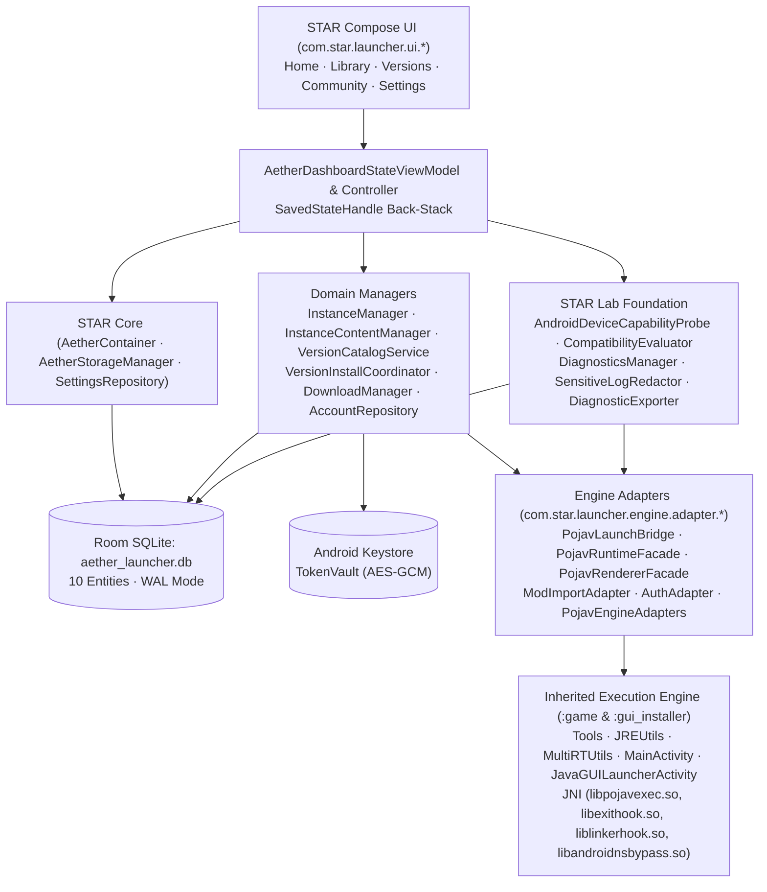

# STAR Launcher — System Architecture

> **Product**: **STAR Launcher** (`STAR`)  
> **Android Application ID**: `com.star.launcher` (`com.star.launcher.debug` in debug builds)  
> **Gradle Application Module**: `:app_pojavlauncher` (`namespace 'net.kdt.pojavlaunch'`)  
> **Kotlin Package Root**: `com.star.launcher`  
> **Inherited Engine Foundation**: `Amethyst-Android` (`166af615d`, `v3_openjdk`) / `PojavLauncher` inside namespace `net.kdt.pojavlaunch`

---

## 1. Layered Architecture Overview

STAR Launcher uses a **hybrid clean-boundary architecture**: modern launcher screens, instance isolation, version catalog orchestration, hardware-backed encryption, compatibility probing, and session diagnostics live in **Kotlin + Jetpack Compose + Room (`com.star.launcher.*`)**, communicating strictly through thin engine adapters with the inherited **Java + JNI + C/C++ execution engine (`net.kdt.pojavlaunch.*`)**.

> **Note on Inherited Internal Identifiers**: Several internal class, database, storage, and Gradle module names (`:app_pojavlauncher`, `PojavApplication`, `TestStorageActivity`, `AetherDashboardActivity`, `AetherContainer`, `AetherStorageManager`, `AetherDatabase`, `aether_launcher.db`, `PojavLaunchBridge`) are intentionally preserved implementation identifiers to protect Room schemas, JNI symbol resolution, and saved user data. They do **not** represent STAR Launcher's user-facing product branding.

---

## 2. Android Process Model

STAR Launcher separates **Gradle module names** (`:app_pojavlauncher`, `:androidnsbypass`, etc.), **Android application identity** (`com.star.launcher` / `.debug`), **Gradle namespace** (`net.kdt.pojavlaunch`), and **Android OS process names** (`:launcher`, `:game`, `:gui_installer`) defined in [`app_pojavlauncher/src/main/AndroidManifest.xml`](../app_pojavlauncher/src/main/AndroidManifest.xml).

Because `<application android:name=".PojavApplication" android:process=":launcher">` declares `:launcher` at the `<application>` level, **every component without an explicit `android:process` attribute runs inside `:launcher`**. In addition, Android instantiates `net.kdt.pojavlaunch.PojavApplication` (an inherited upstream `Application` subclass) inside **each** spawned process (`:launcher`, `:game`, and `:gui_installer`) to initialize `ContextExecutor`, the `latestcrash.txt` uncaught-exception handler, `Tools` / `LauncherPreferences` constants, CPU architecture detection, and `AsyncAssetManager.unpackRuntime()`.

### 2.1 Process Inventory (`AndroidManifest.xml`)

| OS Process | Components Declared in `AndroidManifest.xml` | Responsibilities |
| --- | --- | --- |
| **`:launcher`** *(Default `<application>` process)* | **Activities**: `TestStorageActivity` (`MAIN`/`LAUNCHER`), `AetherDashboardActivity` *(internal class name for STAR Compose hub)*, `LauncherActivity` *(legacy XML/Fragment fallback shell)*, `MissingStorageActivity`, `ImportControlActivity` (`VIEW`/`SEND` JSON control files), `CustomControlsActivity`, `FatalErrorActivity`, `ShowErrorActivity`, `ExitActivity` **Provider**: `scoped.FolderProvider` (`DocumentsProvider`, `@string/storageProviderAuthorities`) **Service**: `services.ProgressService` (`foregroundServiceType="dataSync"`) | Handles startup storage checks and component unpacking (`TestStorageActivity` -> `AetherDashboardActivity`), hosts the STAR Compose UI, manages downloads/accounts/instances/STAR Lab diagnostics, serves scoped files via SAF `FolderProvider`, and **owns all writes to Room SQLite (`aether_launcher.db`)**. |
| **`:game`** *(Isolated game process)* | **Activity**: `MainActivity` (`launchMode="singleTop"`, `sensorLandscape`) **Service**: `services.GameService` (`foregroundServiceType="specialUse"`) | Initializes Android OpenJDK (`libjli.so` / `libjvm.so` via `JREUtils` & `VMLauncher.launchJVM`), LWJGL `3.3.3`/`3.4.1`, EGL/OSMesa/Vulkan graphics bridges, SDL/TouchController input pipes, and `MinecraftGLSurface`. `GameService` keeps the game alive in the background and kills `:game` on task removal or notification termination. |
| **`:gui_installer`** *(Isolated AWT installer process)* | **Activity**: `JavaGUILauncherActivity` (`sensorLandscape`) | Executes standalone Swing/AWT mod installer `.jar` files (such as Forge or OptiFine) via `AWTCanvasView`, Caciocavallo (`caciocavallo` / `caciocavallo17`), `libpojavexec_awt.so`, and `libawt_xawt.so`. |

### 2.2 Cross-Process Launch Handoff & SQLite Safety

1. When the user starts Minecraft from STAR Launcher (`AetherDashboardActivity` / `PojavLaunchBridge`), `ContextAwareDoneListener.executeWithActivity()` checkpoints Room WAL pages via `AetherContainer.flushWalIfInitialized()`, launches `MainActivity` in `:game`, finishes the launcher Activity, and terminates `:launcher` (`android.os.Process.killProcess(Process.myPid())`) so the game JVM reclaims launcher heap and graphics memory.
2. **`:game` never opens `aether_launcher.db` directly.** When Minecraft exits or crashes, `MainActivity` writes an atomic redacted JSON spool file via `CrossProcessSpoolBridge.writeGameExitSpoolJvm()` into `aether_spool/`, which `:launcher` ingests into Room on its next startup.

---

## 3. Gradle Module Topology (`settings.gradle`)

| Module | Type | Purpose |
| --- | --- | --- |
| `:app_pojavlauncher` | `com.android.application` | Preserved application module containing STAR Launcher UI (`com.star.launcher.*`), inherited execution engine (`net.kdt.pojavlaunch.*`), and NDK C/C++ build (`Android.mk`) |
| `:androidnsbypass` | `com.android.library` | CMake native library bypassing Android linker namespaces + ARM64 BTI trampoline for Turnip Vulkan injection |
| `:MioLibPatcher` | `java` (Java 8 toolchain) | Javassist `-javaagent` runtime bytecode patcher for desktop mods (Sodium/Embeddium, OSHI, SQLite, VulkanMod, Narrator) |
| `:arc_dns_injector` | `java-library` (Java 8) | JVM agent fixing Android DNS lookups inside Java `InetAddress` |
| `:forge_installer` | `java-library` (Java 8) | Automated headless Forge GUI installer agent (`org.json`) |
| `:jre_lwjgl3glfw` (`:lwjgl-3.3.3`, `:lwjgl-3.4.1`) | `java` | Merged custom LWJGL3 Android GLFW/EGL/SDL3 JARs packed into `assets/components/lwjgl3/` |

---

## 4. Persistence & Security Architecture

- **Room Database (`AetherDatabase`, v1, `exportSchema = true`)**: Stored under internal legacy filename `aether_launcher.db` with `10` normalized entities (`AppSettingEntity`, `DeviceInfoEntity`, `RuntimeRegistryEntity`, `RendererProfileEntity`, `GameVersionEntity`, `GameInstanceEntity`, `DownloadTaskEntity`, `CompatibilityResultEntity`, `GameSessionEntity`, `DiagnosticLogEntity`). Schema snapshots are exported to `app_pojavlauncher/schemas/com.star.launcher.data.db.AetherDatabase/1.json`. Destructive migrations are prohibited (`MIGRATIONS` array). See [`DATABASE_SCHEMA.md`](DATABASE_SCHEMA.md).
- **Android Keystore Vault (`TokenVault`)**: Encrypts Microsoft OAuth/access/refresh secrets with AES-256-GCM hardware-backed keys (internal alias `aether_token_vault_v1`, stored under `noBackupFilesDir/aether_vault/`). Secret tokens never enter Room tables or `DiagnosticLogs`.
- **DocumentsProvider (`FolderProvider`)**: Exports scoped game folders cleanly to Android file managers using authority `com.star.launcher.scoped.gamefolder` (`.debug` in debug builds).

---

## 5. Native Engine Components (`app_pojavlauncher/src/main/jni/`)

- **`libpojavexec.so`**: JVM launcher (`jre_launcher.c`), EGL/OSMesa/Kopper-Zink dispatch (`egl_bridge.c`, `ctxbridges/*`), 8,000-slot input ring buffer (`input_bridge_v3.c`), `stdio_is.c` log redirection, CPU big-core affinity (`bigcoreaffinity.c`), and JVM native hooks (`jvm_hooks/*`).
- **`libexithook.so`**: ByteHook PLT hooks redirecting `exit`/`atexit`, `chmod`, `dlopen`, and SDL3 initialization (`native_hooks/*`).
- **`liblinkerhook.so`**: Collaborates with `androidnsbypass` (`-z global`) to inject `libvulkan_freedreno.so` (Turnip) on `arm64-v8a` Adreno devices.
- **`libglxshim.so`**: `glXGetProcAddress` -> `eglGetProcAddress` shim for Kopper Zink.
- **`libpojavexec_awt.so` & `libawt_xawt.so`**: AWT framebuffer & headless X11 stub bridges for `:gui_installer`.
