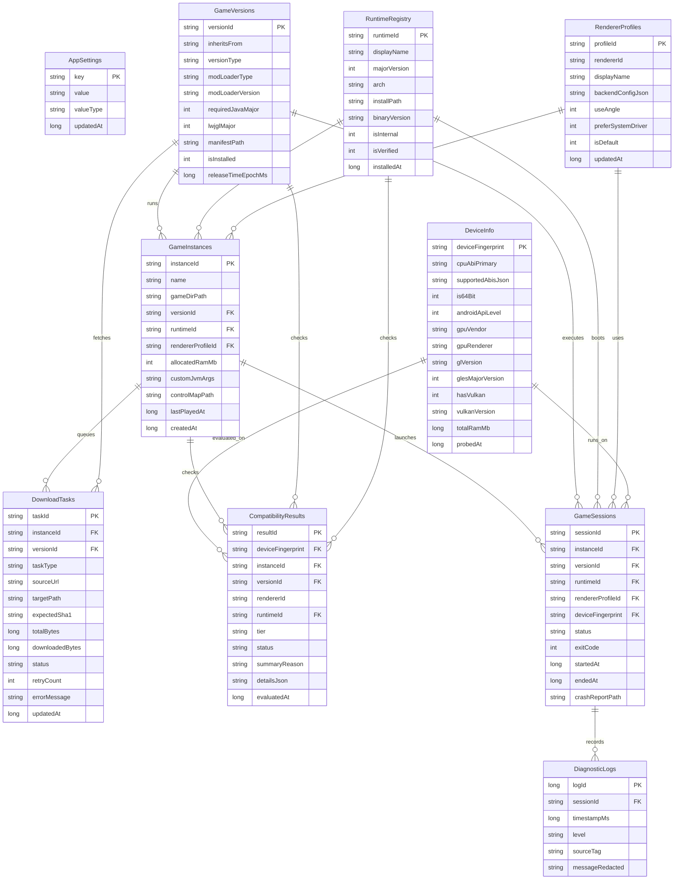

# STAR Database Schema (`M0.2` / `M0.5`)

> **Engine**: AndroidX Room (`SQLite` in WAL mode)  
> **Database Class**: `AetherDatabase` (`version = 1`, `exportSchema = true`)  
> **Phase 0 Constraint**: Design only. **Do NOT migrate or overwrite existing user data (`accounts/*.json`, `launcher_profiles.json`, `SharedPreferences`) during Phase 0.**

---

## 1. Security & Persistence Rules

1. **No Plaintext Authentication Tokens**:
   - Room **never** stores `accessToken`, `refreshToken`, `clientToken`, `msaRefreshToken`, or passwords.
   - If account metadata is cached later, Room stores only non-secret identifiers (`accountId`, `username`, `profileUuid`, `accountType`, `expiresAtEpochMs`, `keystoreAlias`), while sensitive tokens live exclusively in an **Android Keystore (`AES-256-GCM`) encrypted store** (`EncryptedSharedPreferences` or Jetpack Security / Tink AEAD).
2. **Versioned Migrations**:
   - `exportSchema = true` with schema JSON snapshots checked into `app_pojavlauncher/schemas/`.
   - Explicit `Migration(from, to)` objects for every schema bump; `fallbackToDestructiveMigration()` is **forbidden** in production builds.
3. **Transactional Updates & Safe Persistence**:
   - Multi-table mutations (e.g., creating an instance + default compatibility check, or starting/ending a `GameSessions` row + inserting `DiagnosticLogs`) run inside `@Transaction` DAO methods.
   - SQLite journal mode defaults to `WRITE_AHEAD_LOGGING` (`RoomDatabase.JournalMode.WRITE_AHEAD_LOGGING`).
   - Because `:game` (`MainActivity`) runs in a separate OS process from `:launcher`, `:launcher` owns Room writes; `:game` communicates session/log updates via a bound AIDL/ContentProvider/file-spool bridge rather than opening concurrent multi-process SQLite writers.

---

## 2. Entity Relationship Diagram

---

## 3. Room Entity Specifications

### 3.1 `AppSettings` (`tableName = "app_settings"`)
- **Primary Key**: `key: String`
- **Columns**: `value: String`, `valueType: SettingValueType` (`BOOL`, `INT`, `FLOAT`, `STRING`, `JSON`), `updatedAt: Long`
- **Indexes**: `Index(value = ["updatedAt"])`
- **Notes**: Never stores secrets or auth tokens.

### 3.2 `DeviceInfo` (`tableName = "device_info"`)
- **Primary Key**: `deviceFingerprint: String` (hash of ABI + SDK + `GL_VENDOR` + `GL_RENDERER` + Vulkan version)
- **Columns**: `cpuAbiPrimary: String`, `supportedAbisJson: String`, `is64Bit: Boolean`, `androidApiLevel: Int`, `gpuVendor: String`, `gpuRenderer: String`, `glVersion: String`, `glesMajorVersion: Int`, `hasVulkan: Boolean`, `vulkanVersion: String?`, `totalRamMb: Long`, `probedAt: Long`
- **Indexes**: `Index(value = ["probedAt"])`

### 3.3 `RuntimeRegistry` (`tableName = "runtime_registry"`)
- **Primary Key**: `runtimeId: String` (e.g., `"Internal"`, `"External-17"`, `"External-21"`)
- **Columns**: `displayName: String`, `majorVersion: Int`, `arch: String`, `installPath: String`, `binaryVersion: String?`, `isInternal: Boolean`, `isVerified: Boolean`, `installedAt: Long`
- **Indexes**: `Index(value = ["majorVersion", "arch"])`, `Index(value = ["installPath"], unique = true)`

### 3.4 `RendererProfiles` (`tableName = "renderer_profiles"`)
- **Primary Key**: `profileId: String` (UUID)
- **Columns**: `rendererId: String` (e.g., `"opengles_mobileglues"`, `"opengles3_desktopgl_zink_kopper"`), `displayName: String`, `backendConfigJson: String` (e.g., MobileGlues JSON parameters), `useAngle: Boolean`, `preferSystemDriver: Boolean`, `isDefault: Boolean`, `updatedAt: Long`
- **Indexes**: `Index(value = ["rendererId"])`, `Index(value = ["isDefault"])`

### 3.5 `GameVersions` (`tableName = "game_versions"`)
- **Primary Key**: `versionId: String` (e.g., `"1.20.4"`, `"1.20.4-fabric-0.16.9"`)
- **Columns**: `inheritsFrom: String?`, `versionType: String` (`"release"`, `"snapshot"`, `"old_beta"`, `"modded"`), `modLoaderType: ModLoaderType` (`VANILLA`, `FORGE`, `NEOFORGE`, `FABRIC`, `QUILT`, `LWJGL3IFY`, `OTHER`), `modLoaderVersion: String?`, `requiredJavaMajor: Int`, `lwjglMajor: Int`, `manifestPath: String`, `isInstalled: Boolean`, `releaseTimeEpochMs: Long`
- **Indexes**: `Index(value = ["inheritsFrom"])`, `Index(value = ["modLoaderType", "isInstalled"])`

### 3.6 `GameInstances` (`tableName = "game_instances"`)
- **Primary Key**: `instanceId: String` (UUID)
- **Columns**: `name: String`, `gameDirPath: String`, `versionId: String?`, `runtimeId: String?`, `rendererProfileId: String?`, `allocatedRamMb: Int`, `customJvmArgs: String?`, `controlMapPath: String?`, `lastPlayedAt: Long?`, `createdAt: Long`
- **Foreign Keys**:
  - `versionId -> GameVersions.versionId` (`onDelete = SET_NULL`)
  - `runtimeId -> RuntimeRegistry.runtimeId` (`onDelete = SET_NULL`)
  - `rendererProfileId -> RendererProfiles.profileId` (`onDelete = SET_NULL`)
- **Indexes**: `Index(value = ["gameDirPath"], unique = true)`, `Index(value = ["versionId"])`, `Index(value = ["runtimeId"])`, `Index(value = ["rendererProfileId"])`, `Index(value = ["lastPlayedAt"])`

### 3.7 `DownloadTasks` (`tableName = "download_tasks"`)
- **Primary Key**: `taskId: String` (UUID)
- **Columns**: `instanceId: String?`, `versionId: String?`, `taskType: DownloadTaskType` (`VERSION_MANIFEST`, `CLIENT_JAR`, `LIBRARY`, `ASSET`, `RUNTIME`, `MODLOADER`), `sourceUrl: String`, `targetPath: String`, `expectedSha1: String?`, `totalBytes: Long`, `downloadedBytes: Long`, `status: DownloadStatus` (`QUEUED`, `RUNNING`, `PAUSED`, `VERIFYING`, `COMPLETED`, `FAILED`, `CANCELLED`), `retryCount: Int`, `errorMessage: String?`, `updatedAt: Long`
- **Foreign Keys**:
  - `instanceId -> GameInstances.instanceId` (`onDelete = CASCADE`)
  - `versionId -> GameVersions.versionId` (`onDelete = CASCADE`)
- **Indexes**: `Index(value = ["status", "updatedAt"])`, `Index(value = ["instanceId"])`, `Index(value = ["versionId"])`

### 3.8 `CompatibilityResults` (`tableName = "compatibility_results"`)
- **Primary Key**: `resultId: String` (UUID)
- **Columns**: `deviceFingerprint: String`, `instanceId: String?`, `versionId: String?`, `rendererId: String`, `runtimeId: String?`, `tier: CompatibilityTier` (`DETECTED`, `THEORETICAL`, `TESTED`, `VERIFIED_RUNTIME`), `status: CompatibilityStatus` (`PASS`, `WARN`, `FAIL`, `EXPERIMENTAL`, `UNSUPPORTED`), `summaryReason: String`, `detailsJson: String`, `evaluatedAt: Long`
- **Foreign Keys**:
  - `deviceFingerprint -> DeviceInfo.deviceFingerprint` (`onDelete = CASCADE`)
  - `instanceId -> GameInstances.instanceId` (`onDelete = CASCADE`)
  - `versionId -> GameVersions.versionId` (`onDelete = SET_NULL`)
  - `runtimeId -> RuntimeRegistry.runtimeId` (`onDelete = SET_NULL`)
- **Indexes**: `Index(value = ["deviceFingerprint", "tier"])`, `Index(value = ["instanceId", "evaluatedAt"])`, `Index(value = ["versionId"])`, `Index(value = ["runtimeId"])`

### 3.9 `GameSessions` (`tableName = "game_sessions"`)
- **Primary Key**: `sessionId: String` (UUID)
- **Columns**: `instanceId: String`, `versionId: String?`, `runtimeId: String?`, `rendererProfileId: String?`, `deviceFingerprint: String?`, `status: SessionStatus` (`LAUNCHING`, `RUNNING`, `EXITED_OK`, `CRASHED`, `KILLED`), `exitCode: Int?`, `startedAt: Long`, `endedAt: Long?`, `crashReportPath: String?`
- **Foreign Keys**:
  - `instanceId -> GameInstances.instanceId` (`onDelete = CASCADE`)
  - `versionId -> GameVersions.versionId` (`onDelete = SET_NULL`)
  - `runtimeId -> RuntimeRegistry.runtimeId` (`onDelete = SET_NULL`)
  - `rendererProfileId -> RendererProfiles.profileId` (`onDelete = SET_NULL`)
  - `deviceFingerprint -> DeviceInfo.deviceFingerprint` (`onDelete = SET_NULL`)
- **Indexes**: `Index(value = ["instanceId", "startedAt"])`, `Index(value = ["status"])`, `Index(value = ["versionId"])`, `Index(value = ["runtimeId"])`, `Index(value = ["rendererProfileId"])`, `Index(value = ["deviceFingerprint"])`

### 3.10 `DiagnosticLogs` (`tableName = "diagnostic_logs"`)
- **Primary Key**: `logId: Long` (`autoGenerate = true`)
- **Columns**: `sessionId: String`, `timestampMs: Long`, `level: LogLevel` (`DEBUG`, `INFO`, `WARN`, `ERROR`, `FATAL`), `sourceTag: String`, `messageRedacted: String` (tokens/session IDs scrubbed before persistence)
- **Foreign Keys**:
  - `sessionId -> GameSessions.sessionId` (`onDelete = CASCADE`)
- **Indexes**: `Index(value = ["sessionId", "timestampMs"])`, `Index(value = ["sessionId", "level"])`
