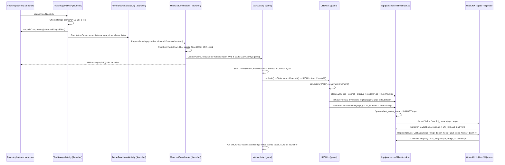

# Engine Dependency Map (`M0.1` / `M0.2`)

> Documents the inherited JVM, LWJGL, JNI, Renderer, Hook, and Native binary execution pipeline inside STAR Launcher (derived from `Amethyst-Android` / `PojavLauncher` in `:app_pojavlauncher`).

---

## 1. End-to-End Runtime Execution Flow

---

## 2. JVM, Agents & Bootclasspath Dependencies

### 2.1 OpenJDK Runtimes (`MultiRTUtils` & `NewJREUtil`)
- **Supported Major Versions**: Java 8 (`Internal` / `External-8`), Java 17 (`Internal-17` / `External-17`), Java 21 (`Internal-21` / `External-21`), Java 25 (`Internal-25` / `External-25`).
- **Storage**: `<data_dir>/runtimes/<name>/` parsed via `release` (`JAVA_VERSION`, `OS_ARCH`) and `pojav_version`.
- **Architecture Rule**: `x86` (32-bit) cannot download Java 21 or 25 (`MultiRTUtils.java:67`, `NewJREUtil.java:186`).
- **Preload Order (`JREUtils.initJavaRuntime`)**: `libjli.so`, `libjvm.so`, `libverify.so`, `libjava.so`, `libnet.so`, `libnio.so`, `libawt.so`, `libawt_headless.so`, `libfreetype.so`, `libfontmanager.so`, plus all remaining `lib*.so` in JRE lib directories via `loader_dlopen.c`.

### 2.2 JVM Agents & Bootclasspath Components (`assets/components/`)
| Component | Path in Assets | Injection Mechanism | Purpose |
|---|---|---|---|
| **Caciocavallo (Java 8)** | `components/caciocavallo/` (`cacio-shared-1.10-SNAPSHOT.jar`, `cacio-androidnw-1.10-SNAPSHOT.jar`, `ResConfHack.jar`) | `-Xbootclasspath/p:...` (`Tools.getCacioJavaArgs`) | Headless/Android AWT toolkit implementation for Java 8 |
| **Caciocavallo (Java 17+)** | `components/caciocavallo17/` (`cacio-shared-1.18-SNAPSHOT.jar`, `cacio-tta-1.18-SNAPSHOT.jar`) | `-Xbootclasspath/a:...` + `--add-exports`/`--add-opens` | Headless/Android AWT toolkit implementation for Java 17/21/25 |
| **Arc DNS Injector** | `components/arc_dns_injector/arc_dns_injector.jar` | `-javaagent:...` (`git.artdeell.arcdns.ArcDNSInjectorAgent`) | Patches Java `InetAddress` DNS cache/lookup on Android (uses `--add-opens=java.base/java.net=ALL-UNNAMED`) |
| **MioLibPatcher** | `components/MioLibPatcher/MioLibPatcher.jar` | `-javaagent:...` (`com.mio.libpatcher.MainAgent`) | Javassist runtime bytecode patches (Sodium/Embeddium Pojav check, OSHI CPU/topology, SQLite/Netty `isAndroid`, Narrator disable, VulkanMod CPU name, ImGui path, optional ASM/ALC10 fixes) |
| **Methods Injector Agent** | `components/methods_injector_agent/` (`methods_injector_agent.jar`, `lwjgl2_methods_injector.jar`) | `-javaagent:...` | Compatibility bytecode injection for legacy LWJGL2 versions/mods |
| **Forge Installer Agent** | `components/forge_installer/forge_installer.jar` | `-javaagent:...` in `JavaGUILauncherActivity` (`git.artdeell.installer_agent.Agent`) | Automates/filters Swing Forge installer UI and fixes installed profile JSON |
| **Log4j RCE Patch** | `components/security/` | `-Dlog4j.configurationFile=...` + `-Dlog4j2.formatMsgNoLookups=true` | Mitigates Log4Shell on vulnerable Minecraft versions |

---

## 3. LWJGL & Window/Input Bridge (`jre_lwjgl3glfw`)

- **Versions Built**: `3.3.3` and `3.4.1`, packaged into `assets/components/lwjgl3/<ver>/` (each with `lwjgl-<ver>-merged-modules.jar`, `lwjgl.jar`, `lwjgl-lwjglx.jar`, `lwjgl-openal.jar`, `lwjgl-vulkan.jar`, `lwjgl-sdl.jar` in 3.4.1, etc., and `version` SHA-1 file).
- **Native Libraries Extracted**: `lwjgl-3.3.3-natives-release.aar` and `lwjgl-3.4.1-natives-release.aar` extract per-ABI `.so` files (`liblwjgl.so`, `liblwjgl_opengl.so`, `liblwjgl_stb.so`, `liblwjgl_nanovg.so`, `liblwjgl_freetype.so`, `liblwjgl_tinyfd.so`, `liblwjgl_vma.so`, `libshaderc.so`, plus `liblwjgl_spng.so` in 3.4.1) into `Tools.DIR_DATA/lwjgl-<ver>-natives/<abi>/`.
- **GLFW Native Bridge (`GLFW.java` <-> `egl_bridge.c` & `input_bridge_v3.c`)**:
  - `nativeEglInit`, `nativeEglCreateContext`, `nativeEglMakeCurrent`, `nativeEglDetachOnCurrentThread`, `nativeEglSwapBuffers`, `nativeEglSwapInterval`, `nativeEglTerminate`.
  - Input event ring buffer (`events[7999]`) + wake pipe (`eventPipe[2]`) for LWJGL3 (`isUseStackQueueCall = true`), or direct cross-VM callback (`CallbackBridge.receiveCallback`) for LWJGL2 (`isUseStackQueueCall = false`).
  - Optional `@CriticalNative` fast-path probed at startup via `CriticalNativeTest.testCriticalNative`.
- **SDL3 Integration (LWJGL 3.4.1 / Controlify / Legacy4J)**:
  - `org.lwjgl.sdl.SDLMouse` + `SDLInit` + `native_hooks/sdl_hook.c` (`libexithook.so`) intercept `libSDL3.so` `JNI_OnLoad` to prevent SDL from overwriting `ANativeWindow` surface lifecycle and forward Android `MotionEvent`/`KeyEvent` directly into SDL3.

---

## 4. Graphics & Renderer Dependency Map

| Renderer ID (`renderer_values`) | Native Libraries Loaded | EGL / Window Bridge | Required Capabilities / Quirks |
|---|---|---|---|
| `opengles2` (**NG-GL4ES / Krypton Wrapper**) | `libng_gl4es.so` (+ optional `libEGL_angle.so`, `libGLESv2_angle.so` if `useANGLE`) | `gl_bridge.c` (`libEGL.so` or `POJAVEXEC_EGL`) + `PojavRendererInit.nativeInitGl4esInternals` | OpenGL ES >= 3 (`Tools.java:1772`); sets `LIBGL_ES=2` |
| `opengles_mobileglues` (**MobileGlues**) | `libmobileglues.so` (+ `libSimpleFPEWrapper.so` for MC `< 1.17`) + optional ANGLE | `gl_bridge.c` (`POJAVEXEC_EGL=libmobileglues.so`) + `MG_DIR_PATH/config.json` | Configurable GL 4.3, Compute Shader, DSA, ANGLE backend, FSR1 |
| `opengles3_desktopgl_zink_kopper` (**Kopper-Zink**) | `libglxshim.so`, `libEGL_mesa.so`, `libglapi.so`, `libzink_dri.so`, `libVkLayer_khronos_timeline_semaphore.so` (+ optional `libvulkan_freedreno.so` via `liblinkerhook.so`) | `gl_bridge.c` (`eglBindAPI(EGL_OPENGL_API)`) + `swap_interval_no_egl.c` (`ANativeWindow::setSwapInterval` vtable call) | Hardware Vulkan; sets `MESA_GL_VERSION_OVERRIDE=4.6COMPAT`; Adreno 740 OneUI UBWC hint (`Tools.shouldUseUBWC()`) |
| `vulkan_zink` (**OSMesa Zink**) | `libOSMesa.so` (+ optional `libvulkan_freedreno.so` via `liblinkerhook.so`) | `osm_bridge.c` (`ANativeWindow_lock` / `unlockAndPost`) + `bigcore_ed_thread` | Hardware Vulkan + `libOSMesa.so` present (optional binary); `MainActivity.java:242` redirects `vulkan_zink` -> `opengles3_desktopgl_zink_kopper`! |
| `opengles3_ltw` (**LTW**) | `libltw.so` | `gl_bridge.c` (`POJAVEXEC_EGL=libltw.so`) | Optional proprietary/external `libltw.so` + GLES >= 3; Adreno render distance `<= 7` mitigation without Sodium (`Tools.java:387`) |
| `opengles_system_gles` (**System GLES**) | `libGLESv2.so` (+ optional `libEGL_angle.so`) | `gl_bridge.c` | Direct GLES path |

---

## 5. Native Hook & Linker Bypass Stack

| Library | Hook Technology | Targets | Why Required on Android |
|---|---|---|---|
| `libexithook.so` | `com.bytedance:bytehook:1.0.10` (PLT hook) | `exit`, `atexit`, `chmod`, `fchmod`, `dlopen` / `__loader_dlopen` / `__loader_android_dlopen_ext`, `dlsym`, `SDL_InitSubSystem`, `SDL_OpenJoystick`, `SDL_OpenGamepad` | Prevents JVM `exit()` from terminating Android UI before showing crash dialog; ignores FUSE `chmod` `EPERM`; redirects `libvulkan.so` / `libawt_xawt.so` / `libOSMesa.so.8`; integrates SDL3 |
| `liblinkerhook.so` + `libandroidnsbypass.so` | ELF symbol lookup in `/bin/linker[64]` + ARM64 `libc.so` `BLR x8` BTI trampoline + `memfd` `DT_SONAME` rewrite | `android_dlopen_ext`, `android_load_sphal_library` | Injects custom Turnip `libvulkan_freedreno.so` (`arm64-v8a`) past Android's restricted `sphal`/vendor linker namespaces |
| `libpojavexec.so` (`jvm_hooks/`) | JNI `RegisterNatives` on OpenJDK classes | `NativeLibraryImpl.open` / `NativeLibrary.load0`, `ProcessImpl.forkAndExec` / `UNIXProcess.forkAndExec`, `SharedLibraryUtil.getLibraryPath` | `RTLD_GLOBAL` symbol visibility for LWJGL/mods; intercepts child `java` spawns; prevents Huawei EMUI 5.1 `dl_iterate_phdr` deadlock |
